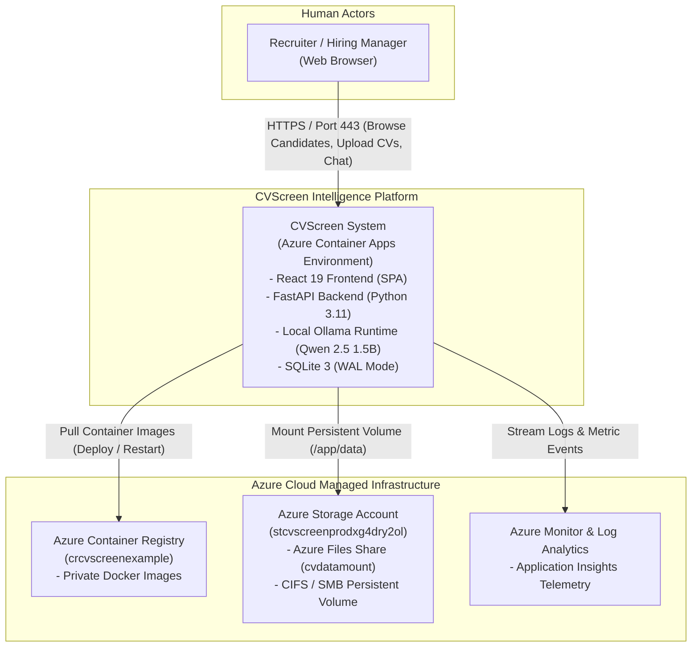
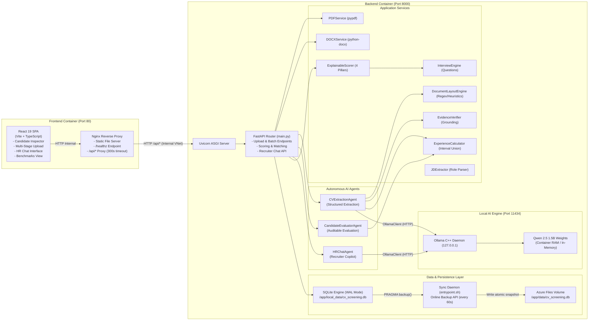
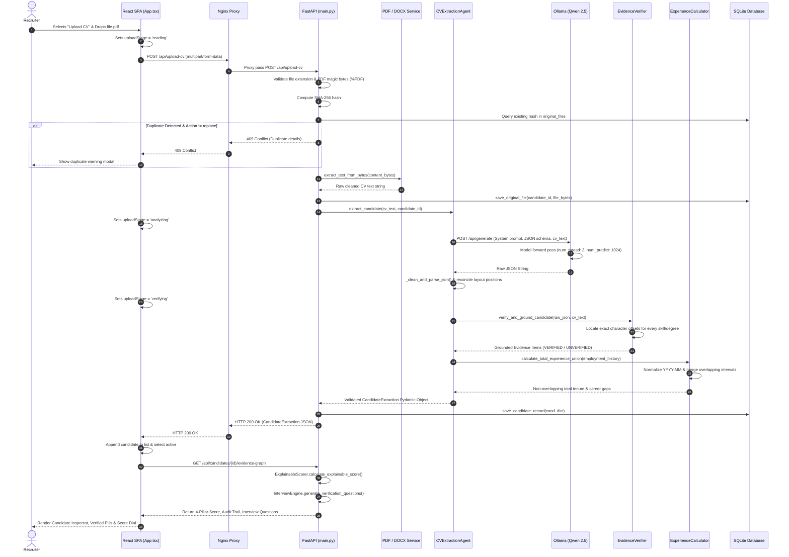
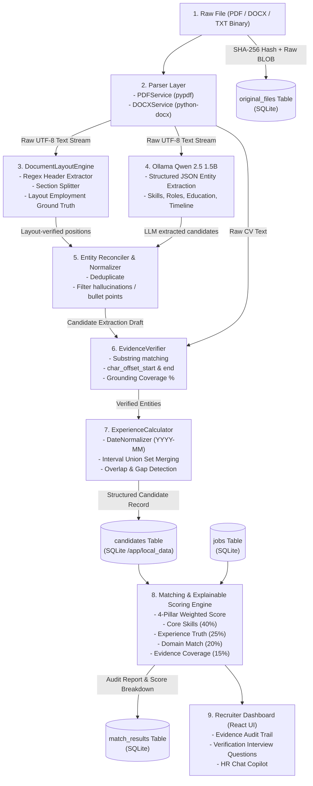
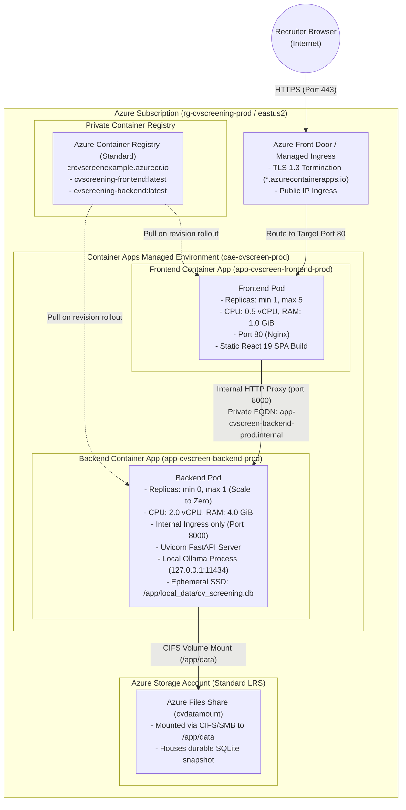
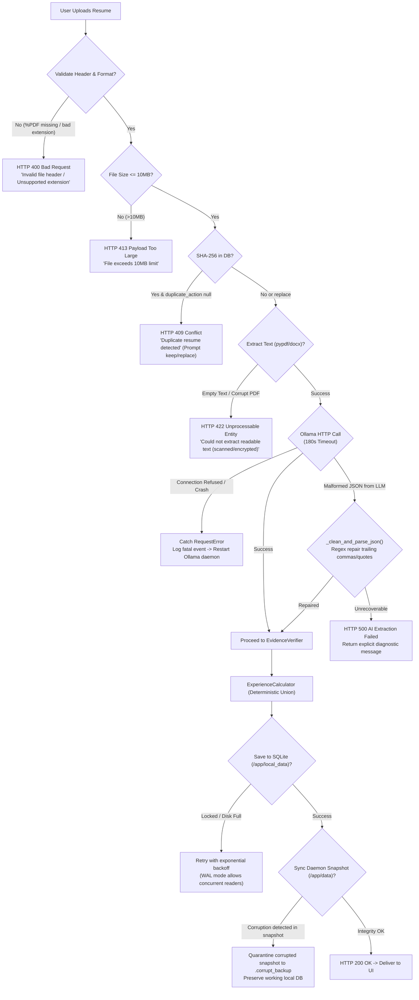

# CVScreen: Complete Architecture Diagrams

**Document**: `ARCHITECTURE_DIAGRAMS.md`  
**Purpose**: Visual architecture reference covering system context, components, runtime sequences, data pipelines, infrastructure topology, and error recovery.

---

## 1. System Context Diagram (C4 Level 1)

This diagram illustrates the high-level boundary of the CVScreen system, the human actors who interact with it, and its external/managed infrastructure dependencies.

---

## 2. Component Architecture Diagram (C4 Level 2)

Detailed view of the internal components inside the Frontend and Backend pods, and how they communicate.

---

## 3. Sequence Diagram: Resume Upload & AI Evaluation

Traces the execution sequence through every layer when a user submits a resume file.

---

## 4. Data-Flow Diagram (DFD)

Traces how candidate information transitions from raw binary to structured, verified intelligence.

---

## 5. Deployment Topology Diagram (Azure Cloud)

Illustrates the network isolation, Azure Container Apps hosting, and persistent file share attachment in production.

---

## 6. Error-Flow & Fault Recovery Diagram

Covers all failure modes: corrupt files, AI timeouts, database locks, and container restarts.

